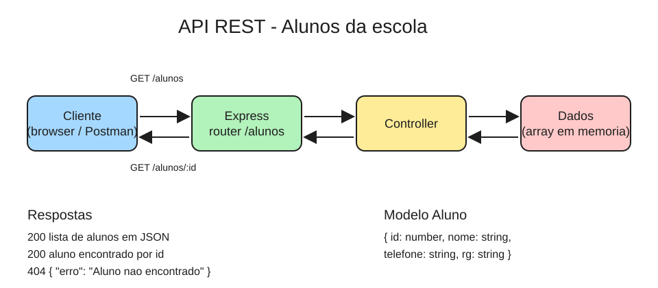

# alunos-rest-express

[](https://github.com/Pedroaruana/alunos-rest-express/actions)


API REST de uma escola ficticia, feita com Node.js e Express, que lista alunos com nome, telefone e RG.

## Diagrama



O arquivo editavel esta em `diagrama-api.excalidraw`.

## Tecnologias

- Node.js
- Express 5
- JavaScript (CommonJS)
- GitHub Actions (CI)
- Excalidraw (diagrama)

## Como rodar

```bash
npm install
npm run dev
```

Servidor em `http://localhost:3000`. A porta pode ser trocada com a variavel `PORT`.

## Endpoints

| Metodo | Rota          | Resposta                                 |
| ------ | ------------- | ---------------------------------------- |
| GET    | `/alunos`     | `200` lista de alunos                    |
| GET    | `/alunos/:id` | `200` aluno ou `404` `{ "erro": "..." }` |

## Exemplos

Listar alunos:

```bash
curl http://localhost:3000/alunos
```

```json
[
  { "id": 1, "nome": "Ana Souza", "telefone": "(11) 91234-5678", "rg": "12.345.678-9" },
  { "id": 2, "nome": "Bruno Lima", "telefone": "(21) 98765-4321", "rg": "23.456.789-0" }
]
```

Buscar por id:

```bash
curl http://localhost:3000/alunos/2
```

```json
{ "id": 2, "nome": "Bruno Lima", "telefone": "(21) 98765-4321", "rg": "23.456.789-0" }
```

Id inexistente:

```bash
curl -i http://localhost:3000/alunos/99
```

```
HTTP/1.1 404 Not Found

{ "erro": "Aluno nao encontrado" }
```

## Modelo

```json
{ "id": 1, "nome": "Ana Souza", "telefone": "(11) 91234-5678", "rg": "12.345.678-9" }
```

## Estrutura

```
src/
  server.js
  routes/alunos.js
  data/alunos.js
docs/diagrama-api.svg
diagrama-api.excalidraw
.github/workflows/ci.yml
```

## Desafio da aula

Modelar em um diagrama uma API REST que lista os dados de alunos de uma escola ficticia (nome, telefone e RG) e implementar o que foi desenhado com Node.js e Express.

## Aprendizados

- Desenhar o fluxo (cliente, router, controller, dados) antes de codar
- Separar rotas e dados em arquivos diferentes
- Usar `Router` do Express e status HTTP corretos (200 e 404)
- Configurar um workflow simples de CI no GitHub Actions

## Autor

Pedro Aruana - [@Pedroaruana](https://github.com/Pedroaruana)

## Licenca

[MIT](LICENSE)
